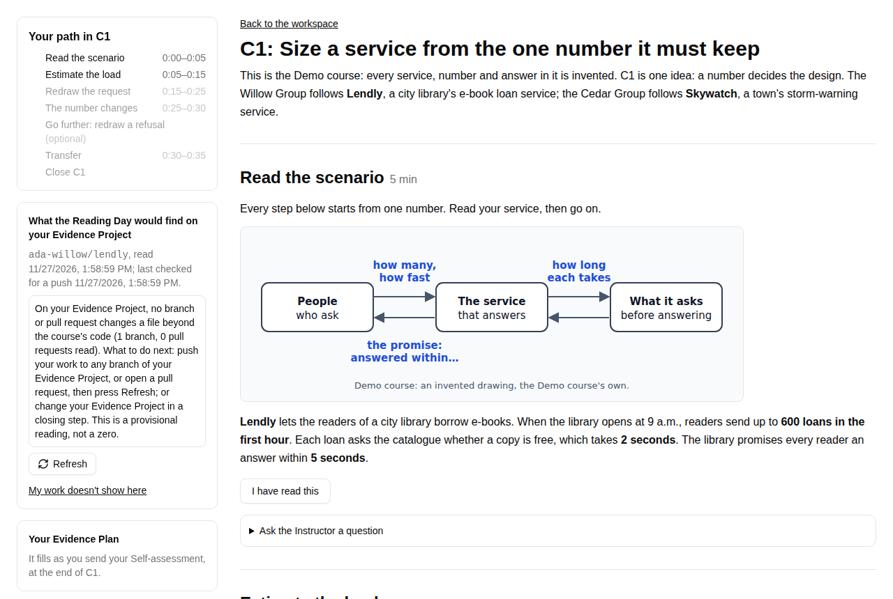
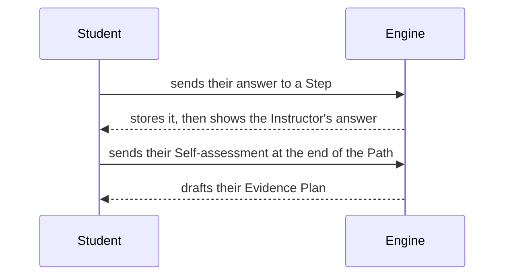
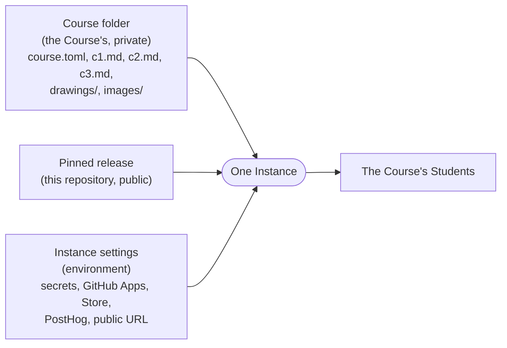
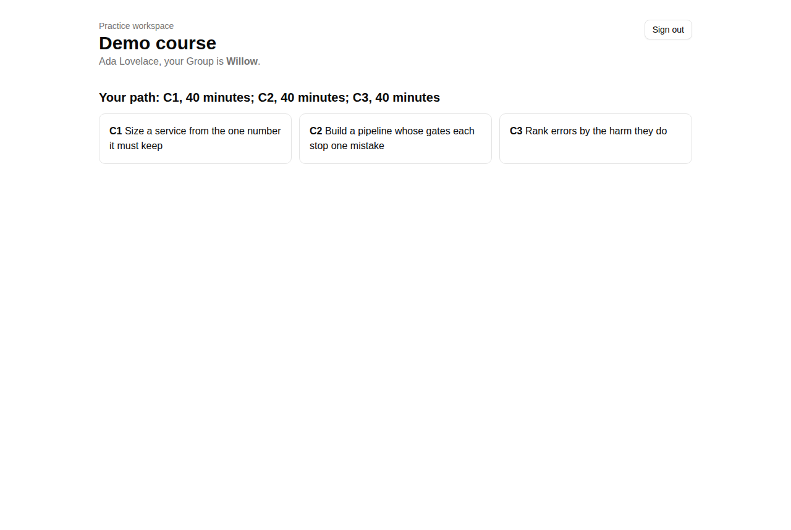
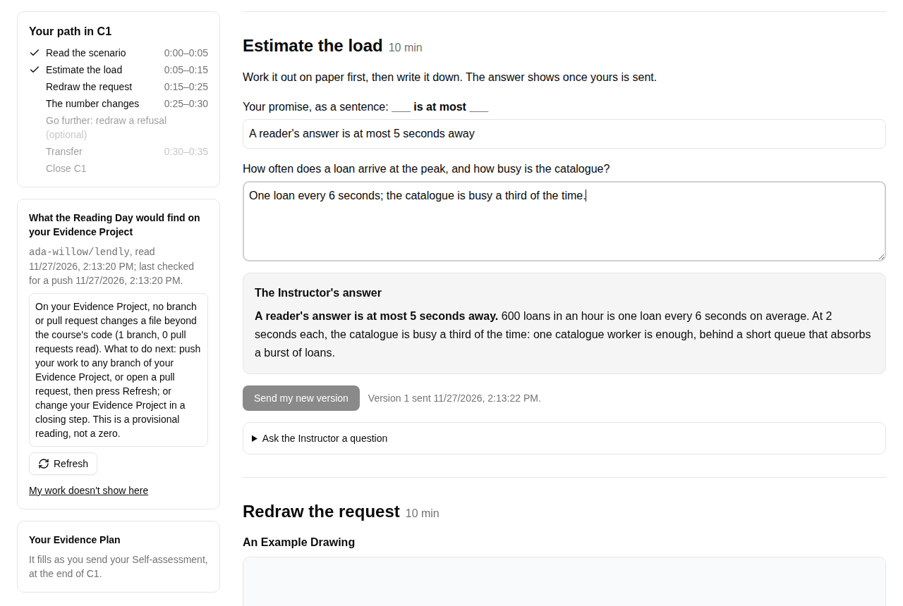
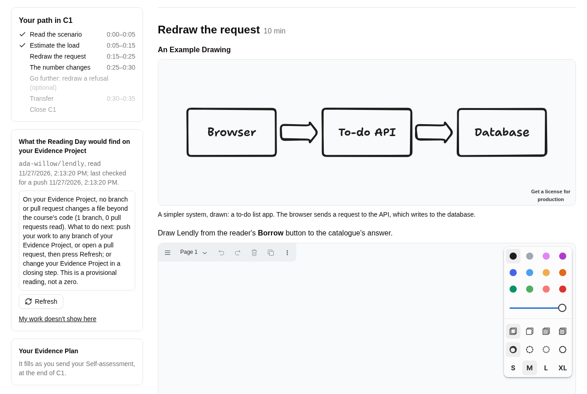
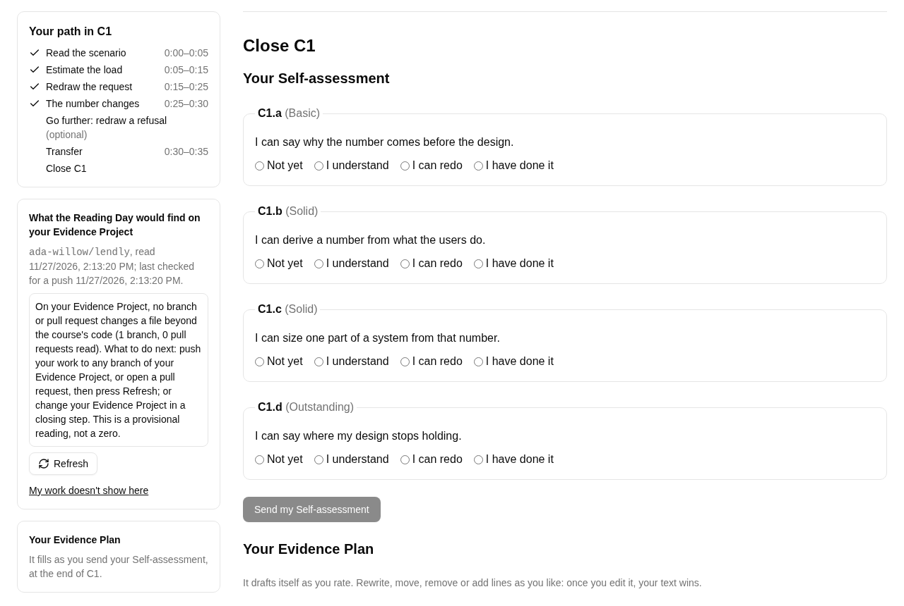

# Practice workspace

Each Student of a Course practises its Competencies on their own, one Path at a time. They read the material, answer, and redraw its systems, and they see the Instructor's answer only once their own is stored. They leave with a Self-assessment and an Evidence Plan.



## Who it is for

- **Students**, who walk a Path for each of the Course's three Competencies, C1, C2 and C3.
- **Instructors**, who write a Course's material once, as Markdown in a Course folder, and run the Engine on it.

It was written for the Courses of EPF's MDE programme. It holds none of them: the only Course here is the Demo course, which is wholly fictional.

## A Student's Path

One Step at a time, the Student's own answer before the Instructor's:



## How a Course runs it

The Engine is public; a Course's material is not. Each Course runs its own Instance: a pinned release of the Engine, started on its own Course folder with its own Instance settings ([ADR-0001](./docs/adr/0001-one-public-engine-and-one-instance-per-course.md)).



- **Course folder**, named by `WORKSPACE_COURSE_FOLDER`: `course.toml` gives the Course's name, its Groups (name, Group block, Upstream repository), C1–C3's titles and minutes, the Scale, the Close and the Reading Day, and what is read when a Student declares no Evidence Project. Beside it: `c1.md`, `c2.md`, `c3.md`, the drawings and the images.
- **Instance settings**, in the environment: everything that is not the Course's material. Secrets, the GitHub Apps, the Store's repository, PostHog, the public URL and the tldraw licence key.

[`demo-course/`](./demo-course/) is a complete Course folder and shows the format. The Engine refuses to start on a Course folder it cannot serve, and names every problem. To check a folder before an Instance starts on it, run this from `backend/`:

```sh
uv run python -m app verify <course folder>
```

## Run the Demo course

You need Node 24 and [uv](https://docs.astral.sh/uv/).

```sh
npm run setup
npm run demo
```

Then open <http://localhost:8000/auth/login?github_id=1001> to sign in as a fictional Student. Any id in [`demo-course/roster.csv`](./demo-course/roster.csv) works. Sign-in is faked, and nothing is kept once the server stops.

## Screenshots

`npm run screenshots` starts the Demo course on a free port with fake sign-in, walks a Path with [agent-browser](https://github.com/vercel-labs/agent-browser), and saves the screenshots below to [`docs/screenshots/`](./docs/screenshots/). If agent-browser finds no Chrome, `npx agent-browser install` downloads one.

The workspace, with the Student's three Competencies:



A Step after the Student's own answer: the Instructor's answer shows.



A drawing Step: the Example Drawing, then the Student's canvas.



The closing step: the Self-assessment, which drafts the Evidence Plan.



## Working on it

Read [CLAUDE.md](./CLAUDE.md). `npm run check` runs everything, and a pre-commit hook runs its fast part. The words are in [GLOSSARY.md](./GLOSSARY.md), the decisions in [docs/adr/](./docs/adr/).

## Credits

The guardrail and the software factory come from the [Software Factories for Real Engineers](https://www.aihero.dev/cohorts/software-factories-for-real-engineers-xdy1m) cohort's repository, [ai-hero-dev/cohort-005-project@4339a30](https://github.com/ai-hero-dev/cohort-005-project/tree/4339a3095c5d85e4fb2b3b60ff6c1e6d18147180), with CI on every pull request on top. From it:

- copied: the `code-review`, `pr` and `retro` skills in `.claude/skills/`, the `.sandcastle/` folder, the `agent-implement`, `agent-review`, `agent-explore` and `agent-implement-spec` workflows, `scripts/check-file-tokens.js` and `lint-rules/input.js` (with the glossary's words);
- adapted: `tsconfig.json`, `scripts/pre-commit.sh` (with the back end's jobs added) and the rules in [CODING_STANDARDS.md](./CODING_STANDARDS.md).

The `pr` skill's menu of visuals for its Summary section comes from [Dex Horthy](https://github.com/dexhorthy)'s [`show-me`](https://github.com/humanlayer/skills/blob/main/plugins/show-me/skills/show-me/SKILL.md) skill (HumanLayer), copied almost word for word.

## Licence

[MIT](./LICENSE).
