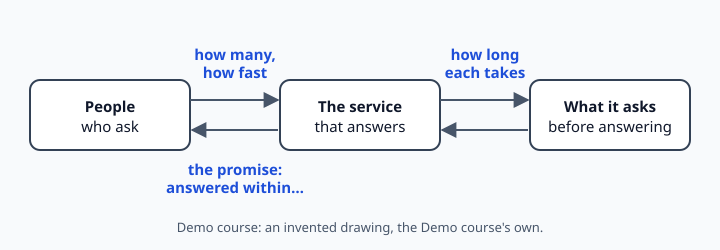

This is the Demo course: every service, number and answer in it is invented. C1 is one idea: a number decides the design. The Willow Group follows **Lendly**, a city library's e-book loan service; the Cedar Group follows **Skywatch**, a town's storm-warning service.

## Read the scenario {#read-the-scenario minutes=5}

Every step below starts from one number. Read your service, then go on.

::: willow
**Lendly** lets the readers of a city library borrow e-books. When the library opens at 9 a.m., readers send up to **600 loans in the first hour**. Each loan asks the catalogue whether a copy is free, which takes **2 seconds**. The library promises every reader an answer within **5 seconds**.
:::

::: cedar
**Skywatch** sends a text message to every subscriber of a town when a storm warning is issued. The town has **12,000 subscribers**. The message gateway takes **100 messages a second** on each connection. The town promises every subscriber the warning within **2 minutes**.
:::

## Estimate the load {#estimate-the-load minutes=10}

Work it out on paper first, then write it down. The answer shows once yours is sent.

::: willow
::: field {#sentence kind=line}
Your promise, as a sentence: **___ is at most ___**
:::

::: field {#step-1 kind=text}
How often does a loan arrive at the peak, and how busy is the catalogue?
:::

::: answer
**A reader's answer is at most 5 seconds away.** 600 loans in an hour is one loan every 6 seconds on average. At 2 seconds each, the catalogue is busy a third of the time: one catalogue worker is enough, behind a short queue that absorbs a burst of loans.
:::
:::

::: cedar
::: field {#sentence kind=line}
Your promise, as a sentence: **___ is at most ___**
:::

::: field {#step-1 kind=text}
How long does one connection take to send every warning?
:::

::: answer
**The last warning leaves at most 2 minutes after the first.** 12,000 messages at 100 a second take 120 seconds on one connection: exactly the limit, with no time left for a retry. Skywatch opens two connections and sends everything in 60 seconds.
:::
:::

## Redraw the request {#redraw minutes=10 kind=drawing}

::: example-drawing {src=drawings/c1-example.json}
A simpler system, drawn: a to-do list app. The browser sends a request to the API, which writes to the database.
:::

::: willow
::: canvas
Draw Lendly from the reader's **Borrow** button to the catalogue's answer.
:::

::: reference-drawing {src=drawings/c1-willow-reference.json}
Lendly, drawn by the Instructor.

::: check-point {#willow-queue point=C1.b}
A queue sits between the Loan API and the catalogue: it absorbs the 9 a.m. burst.
:::

::: check-point {#willow-one-worker point=C1.c}
One catalogue worker, because the number says it is busy a third of the time.
:::

::: check-point {#willow-answer point=C1.b}
The reader gets an answer within 5 seconds, even when the loan is still waiting.
:::
:::
:::

::: cedar
::: canvas
Draw Skywatch from the **Issue warning** button to the subscriber's phone.
:::

::: reference-drawing {src=drawings/c1-cedar-reference.json}
Skywatch, drawn by the Instructor.

::: check-point {#cedar-queue point=C1.b}
A send queue holds the 12,000 messages, so the Alert API answers at once.
:::

::: check-point {#cedar-two-senders point=C1.c}
Two senders, one per gateway connection, because one connection takes the whole 2 minutes.
:::

::: check-point {#cedar-retry point=C1.b}
A message the gateway refuses goes back to the queue for a retry.
:::

::: check-point {#cedar-gateway point=C1.c}
The gateway's 100 messages a second is the limit the drawing is built around.
:::
:::
:::

## The number changes {#the-number-changes minutes=5}

One assumption changes. Redo the calculation in your head before you write.

::: willow
A second library joins Lendly: the peak doubles to **1,200 loans in the first hour**.

::: field {#what-moves kind=text}
What moves in your drawing, and what stays?
:::

::: answer
**The queue's load moves, the design stays.** 1,200 loans an hour is one every 3 seconds: the catalogue is now busy two thirds of the time, and a burst waits longer. Lendly adds a second catalogue worker behind the same queue; the Loan API does not change.
:::
:::

::: cedar
Skywatch's town merges with its neighbour: **30,000 subscribers**.

::: field {#what-moves kind=text}
What moves in your drawing, and what stays?
:::

::: answer
**The number of senders moves, the chain stays.** 30,000 messages at 100 a second take 300 seconds on one connection. Four connections send them in 75 seconds, inside the 2 minutes with time for retries; the queue and the Alert API do not change.
:::
:::

## Go further: redraw a refusal {#redraw-more minutes=0 kind=drawing optional=yes}

::: example-drawing {src=drawings/c1-more-example.json}
The to-do app again, when its queue is full: it refuses the request and says when to try again.
:::

::: canvas
Draw your service from a request to its polite refusal, when the queue is full.
:::

::: reference-drawing {src=drawings/c1-more-reference.json}
A refusal, drawn by the Instructor.

::: check-point {#more-full point=C1.d}
The queue has a size, set from the number.
:::

::: check-point {#more-refusal point=C1.d}
A full queue answers at once, rather than letting the request wait forever.
:::

::: check-point {#more-retry point=C1.d}
The refusal says when to try again.
:::
:::

## Transfer {#transfer minutes=5 kind=transfer fills=C1.b}

Now on a project of your own: find the number that decides its design.

::: field {#project kind=line}
Your project's address (empty: your Evidence Project)
:::

::: field {#requirement kind=text}
One requirement of your project, and the number behind it
:::

## Close C1 {#closing minutes=0 kind=closing}

::: point {#C1.a band=Basic}
I can say why the number comes before the design.

::: proof
A README that states the number before it describes the design.
:::

::: to-get-there {level=not-yet}
Read the scenario again, and find the number in it.
:::

::: to-get-there {level=understand}
Explain to a classmate why the number came first.
:::

::: to-get-there {level=redo}
Write the number at the top of your project's README.
:::
:::

::: point {#C1.b band=Solid}
I can derive a number from what the users do.

::: proof
The calculation behind one of my project's numbers.
:::

::: to-get-there {level=not-yet}
Redo the step "Estimate the load".
:::

::: to-get-there {level=understand}
Redo the calculation with another assumption.
:::

::: to-get-there {level=redo}
Derive a number on your own project.
:::
:::

::: point {#C1.c band=Solid}
I can size one part of a system from that number.

::: proof
A part of my project sized from its number, with the calculation beside it.
:::

::: to-get-there {level=not-yet}
Compare your drawing with the Instructor's.
:::

::: to-get-there {level=understand}
Size the queue of the step "The number changes".
:::

::: to-get-there {level=redo}
Size one part of your own project.
:::
:::

::: point {#C1.d band=Outstanding}
I can say where my design stops holding.

::: proof
The limit of my design, written down, and what would change past it.
:::

::: to-get-there {level=not-yet}
Read the step "The number changes" again.
:::

::: to-get-there {level=understand}
Change one assumption until the design breaks.
:::

::: to-get-there {level=redo}
Find your own project's limit.
:::
:::
